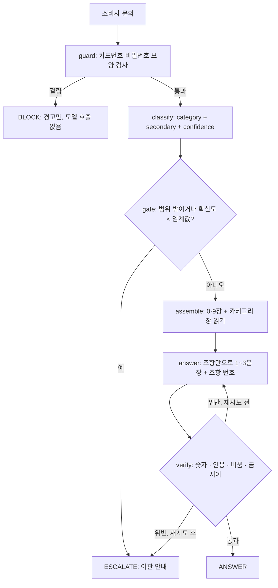

# REPORT · 링커밋 쇼핑몰 소비자 응대 에이전트

> **상태: 뼈대 (구현 시작 전, 2026-11-02).** `(구현 뒤 채움)` 칸은 아직 없는 사실이라 비워 두었다. 1~3번의 설계 내용은 [`PRD.md`](PRD.md) 의 결정을 옮긴 **초안**이고, 구현하면서 달라지면 이 문서를 고친다. 4~7번의 숫자·캡처·회고는 **직접 돌려 본 뒤에만** 쓴다.
> 제출 후 수정이 불가하므로 마지막에 `(구현 뒤 채움)` 과 이 안내 줄이 **하나도 남지 않았는지** 검색해서 확인한다.

## 1. 주제와 근거 문서

**주제** — 링커밋 쇼핑몰에 들어온 **소비자 문의 한 건**을 받아 카테고리를 판정하고, 그 카테고리의 근거 조항만 읽어 **근거만으로 답하고 조항 번호를 보이며**, 모르면 사람에게 넘기는 에이전트.

**왜 이 주제인가**
- 링커밋은 내가 운영하는 플랫폼이고, 수업 뒤 쇼핑몰(소비자 응대)에 옮겨 붙일 설계로 만든다.
- 노드의 주제 조건 셋에 맞는다 — 카테고리가 4개 + 범위 밖이고 카테고리마다 답이 다르다 / 카테고리별로 나눌 만한 근거 문서가 필요하다 / 문서에 없는데 그럴듯하게 답할 수 있는 질문이 있다(환불 입금 기간, 결제수단, 재입고 일정 등).
- 응대 대상은 **소비자만**이다. 제조사·마케터 문의는 범위 밖이다.

**근거 문서는 내가 새로 썼다 — 실제 약관이 아니다**
- 소비자용 이용약관·환불정책은 플랫폼에 아직 없다(`launch-checklist.md` 에 "법무 검토 전 초안, 대기", 고객센터 연락처 `[확정 전]`). 그래서 링커밋의 코드와 PRD 에서 **확인되는 사실만** 모아 장별 파일 6개로 썼다. 법무 검토는 하지 않았다.
- 문장마다 태그가 둘뿐이다 — **[확정]**(링커밋 코드·PRD 로 확인됨, 출처 파일을 조항 옆에 적음)과 **[비움]**(아직 정해지지 않아 **일부러 쓰지 않은 칸**). 내가 지어낸 정책을 넣는 태그는 쓰지 않았다.
- 참고한 레퍼런스는 쿠팡·네이버 고객센터의 **카테고리·장 구성 뼈대**뿐이다. 답변 본문은 수집돼 있지 않아 문장은 새로 썼다.

| 항목 | 값 |
|---|---|
| 장 파일 수 | (구현 뒤 채움) |
| 총 글자 수 | (구현 뒤 채움) |
| `[확정]` 조항 수 / `[비움]` 항목 수 | (구현 뒤 채움) |
| 출처로 쓴 링커밋 파일 | (구현 뒤 채움 — 조항 옆 출처 목록을 모아서) |

## 2. 카테고리 설계

**나눈 근거** — 링커밋 소비자의 **실제 화면 여정**을 따랐다. 주문서 → 상품 상세 → 주문내역·배송 상태 → 취소 순서이고, 장마다 답하는 근거와 값이 다르다(주문 = 동의·재고, 상품 = 고시·옵션·품절, 배송 = 출고 기한·상태 배지, 취소 = 배송 전·후 규칙·환불액).

| 카테고리 | 연결 장 | 기대 도구 | 그 장이 답하는 것 |
|---|---|---|---|
| `ORDER_PAY` 주문·결제 | 1장 | `get_order_policy` | 구매 흐름 · 옵션 선택 · 재고 · 결제 전 동의 |
| `PRODUCT` 상품·재고 | 2장 | `get_product_policy` | 상세 탭 · 상품정보제공고시 · 품절 옵션 · 판매 불가 |
| `SHIPPING` 배송 | 3장 | `get_shipping_policy` | 출고 기한 · 무료배송 · 상태 배지 · 운송장 |
| `CANCEL_REFUND` 취소·반품·교환·환불 | 4장 | `get_cancel_policy` | 배송 전 즉시 취소 · 일부 수량 취소 · 배송 후 안내 |
| `OUT_OF_SCOPE` 범위 밖 | 9장 | (없음 → 이관) | 쿠폰·적립 · 회원 · 제조사·마케터 문의 |
| (항상 넣음) | 0장 · 9장 | — | 책임·성격 · 이관 안내 |

- 위 표는 PRD 의 **초안** 매핑이다. 구현하며 달라진 칸이 있으면 여기에 고치고 이유를 적는다. 최종: (구현 뒤 확인)
- 항상 넣는 0·9장에는 카테고리 전용 숫자·기한·금액을 넣지 않았다. 검사 결과: (구현 뒤 채움 — 컨텍스트 분리 검사)
- 경계 문항(두 카테고리에 걸친 것)은 `secondary` 로 두 번째 장까지 읽게 했다. (구현 뒤 확인)

## 3. 평가셋 설계

| 항목 | 값 |
|---|---|
| 평가용 | 20건 — 카테고리 4개 × 4건 + 범위 밖 4건 (구현 뒤 실제 건수로 확인) |
| 넘기기가 정답인 문항 | 8건(40%) — `[비움]` 에 걸리는 질문과 범위 밖 질문 |
| 예시용(프롬프트에 넣음) | 6건 이상, 평가용과 **id · 질문 문장 중복 0** (구현 뒤 중복 검사 결과 기록) |

- **기대 도구와 필수 사실을 정한 근거** — 기대 도구는 위 매핑표, 필수 사실은 **조항에 적힌 값**이다. ANSWER 문항의 정답은 `[확정]` 조항에서만 나오게 했다.
- **`forbid`(말하면 안 되는 것)** — 문서를 안 읽었을 때 나오기 쉬운 그럴듯한 오답이다(예: 환불 입금 기간을 "영업일 3일 이내"로 지어내기, 품절 옵션도 대기 주문이 된다고 하기).
- **평가용과 예시용을 가른 방법** — 파일을 나눴고(`data/fewshot.json` · `data/goldenset.json`) 중복 검사로 누수를 확인했다. (구현 뒤 채움)
- 문항 문장은 실제 소비자 말투(주문번호 없는 짧은 말)로 썼다. (구현 뒤 확인)

## 4. 측정 결과

**측정 환경** — `-latest` 별칭은 움직이므로 측정마다 적는다.

| 측정 | 날짜 | 분류 모델 | 답변 모델 | 채점 모델 | 임계값 |
|---|---|---|---|---|---|
| 기준 측정 | (구현 뒤 채움) | (구현 뒤 채움) | (구현 뒤 채움) | (구현 뒤 채움) | (구현 뒤 채움) |

**채점기 자기검증** — 모범 답안 20건 통과: (구현 뒤 채움) / `forbid` 를 어긴 오답 3건 불통과: (구현 뒤 채움)

**지표**

| 지표 | 기준 측정 | 개선 1 | 개선 2 |
|---|---|---|---|
| 도구 호출 적절성 | (구현 뒤 채움) | | |
| 답변 적절성 | (구현 뒤 채움) | | |
| 넘기기 정답 8건 중 넘긴 수 | (구현 뒤 채움) | | |
| `[비움]` 을 채운(지어낸) 답 | (구현 뒤 채움) | | |
| 분류 정확도 · macro F1 | (구현 뒤 채움) | | |

혼동 행렬(행 = 정답, 열 = 예측): (구현 뒤 채움)

**틀린 건의 원인 분류** — 점수만 세지 않고 문항을 직접 읽고 적는다.

| 문항 id | 무엇이 틀렸나 | 원인 부품 (분류 · 조회 · 생성 · 검증) | 근거 |
|---|---|---|---|
| (구현 뒤 채움) | | | |

**개선 시도 기록** — 한 번에 하나만 바꾸고 매번 다시 쟀다.

| # | 바꾼 것 (하나) | 왜 | 전 → 후 | 판단 |
|---|---|---|---|---|
| 1 | (구현 뒤 채움) | | | |
| 2 | (구현 뒤 채움) | | | |

## 5. 파이프라인 구조도

> 계획 단계의 그림이다. **구현한 그래프와 대조해 다르면 고친다.** (구현 뒤 확인)

**State** — `question` · `category` · `secondary` · `confidence` · `action` · `called_tools` · `context` · `clause_ids` · `answer` · `citations` · `violations` · `retries` · `trace` (자세한 뜻은 [`tech_spec.md`](tech_spec.md) 2절).

**판단한 것** — 판정(`classify`)과 넘기기(`gate`)를 분리했고, `gate` 와 `verify` 는 **모델을 부르지 않는다.** 읽기 도구는 모델이 고르지 않고 코드가 카테고리에 따라 부른다. (구현 뒤 실제와 대조)

## 6. 데모 설계

- 신경 쓴 부분: 답변 아래에 **호출한 도구 · 근거 조항(번호 + 본문) · 검증 결과 · 넘김 여부**를 한 화면에 보여 준다. 키가 없으면 안내 문구만 나온다. (구현 뒤 확인)
- 시연한 입력: 정상 3종 · 넘기기 2종 · 카드번호 모양 입력 1종. (구현 뒤 채움)
- 화면 캡처: `report-img/` — (구현 뒤 채움)

## 7. 프로젝트 회고

- **가장 공들인 부분** — (구현 뒤 채움)
- **향후 보완하고 싶은 개선점** — (구현 뒤 채움). 이번 범위 밖으로 둔 것: 주문 조회 도구(로그인·본인 확인 필요) · 쇼핑몰 화면 위젯(TypeScript 재구현) · 멀티턴 · 환불 정책 확정과 법무 검토.
