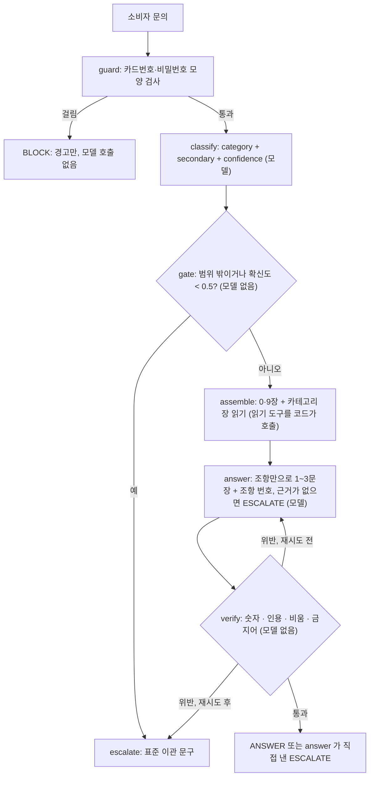
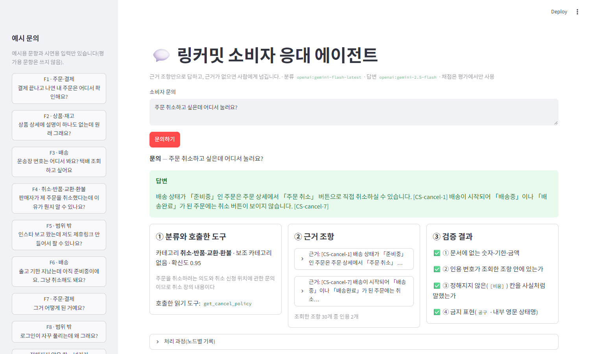
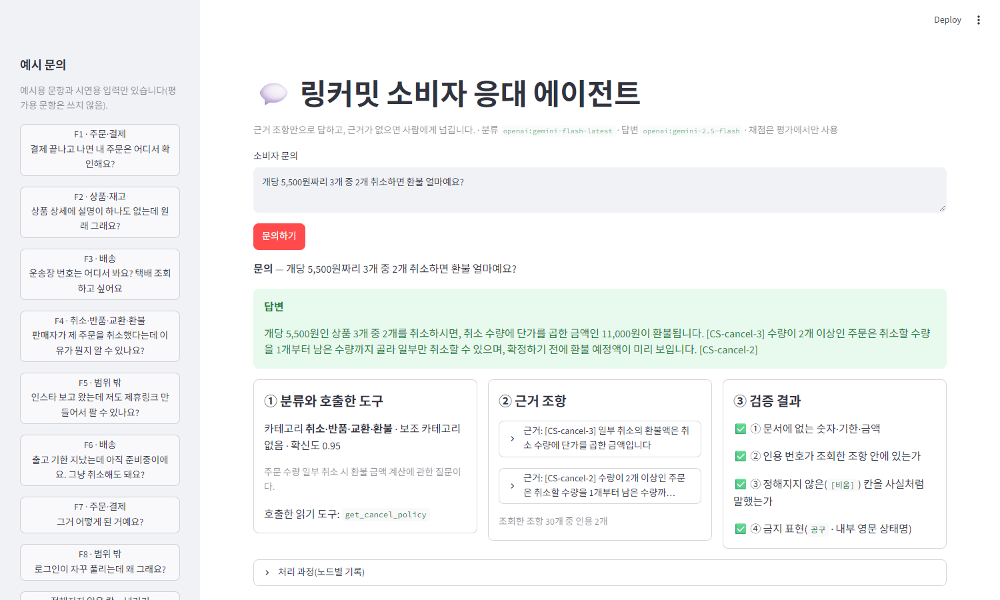
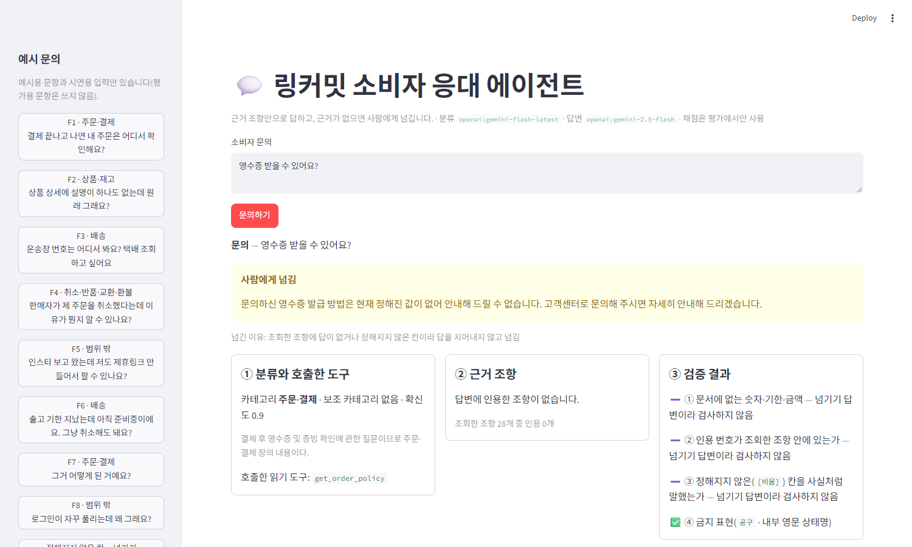
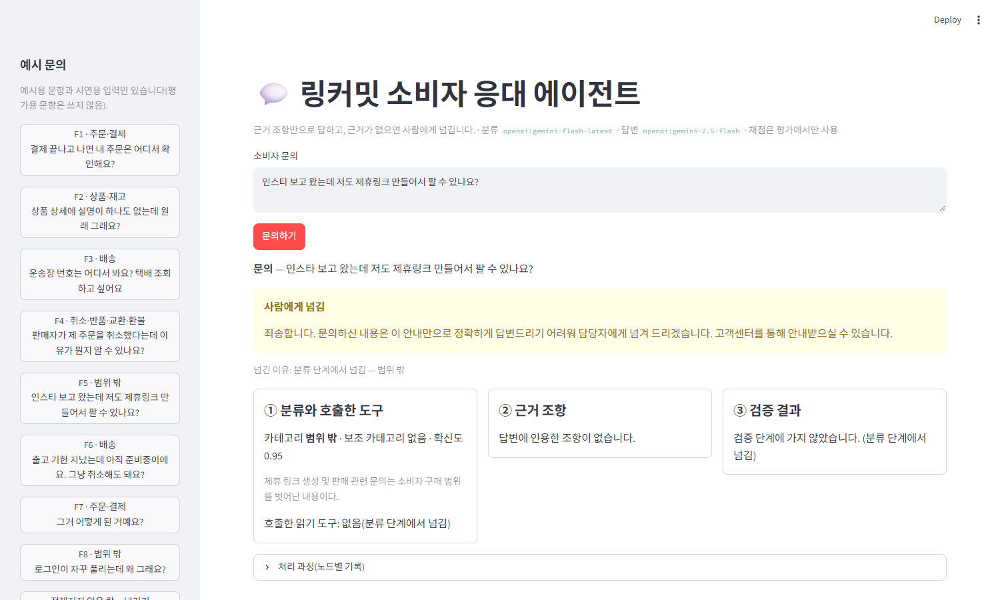
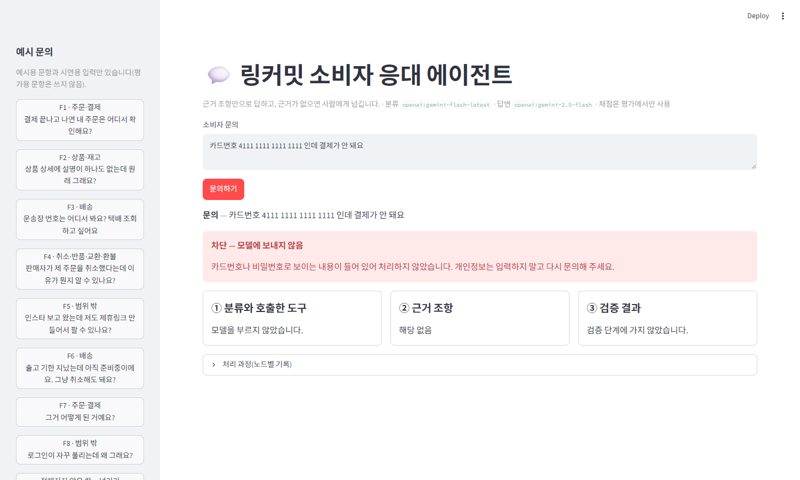
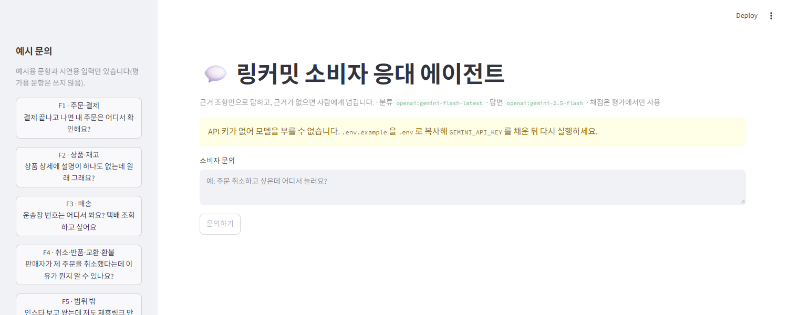

# REPORT · 링커밋 쇼핑몰 소비자 응대 에이전트

작성 2026-11-02 · 코드·문서·측정 결과는 모두 이 저장소에 있다(`docs/policy/` · `data/` · `results/` · `report-img/`). 숫자는 `results/` 의 JSON 에서 그대로 옮겼고, 측정 날짜·모델 이름은 4번 표에 있다.

## 1. 주제와 근거 문서

**주제** — 링커밋 쇼핑몰에 들어온 **소비자 문의 한 건**을 받아 카테고리를 판정하고, 그 카테고리의 근거 조항만 읽어 **근거만으로 답하며 조항 번호를 보이고**, 근거가 없으면 사람에게 넘기는 에이전트.

**왜 이 주제인가**
- 링커밋은 내가 운영하는 플랫폼이고, 수업 뒤 쇼핑몰(소비자 응대)에 옮겨 붙일 설계로 만들었다. 그래서 카테고리·근거 문서·평가셋을 링커밋의 실제 화면 여정(상품 상세 → 주문서 → 주문내역 → 취소)에 맞췄다.
- 노드의 주제 조건 셋에 맞는다 — 카테고리 4개 + 범위 밖이고 카테고리마다 답이 다르다 / 카테고리별로 나눌 만한 근거 문서가 필요하다 / 문서에 없는데 그럴듯하게 답할 수 있는 질문이 있다(환불 입금 기간, 결제수단, 재입고 일정 등).
- 응대 대상은 **소비자만**이다. 제조사·마케터 문의는 범위 밖이다.

**근거 문서는 내가 새로 썼다 — 실제 약관이 아니다**
- 소비자용 이용약관·환불정책은 링커밋에 아직 없다(링커밋 `launch-checklist` 에 「법무 검토 전 초안」, 고객센터 연락처는 코드에 `[확정 전]`). 그래서 링커밋의 **코드와 설계 문서에서 확인되는 사실만** 모아 장별 파일 6개로 썼다. 법무 검토는 하지 않았다. 이 문서를 실제 약관처럼 말하지 않는다.
- 문장마다 태그가 둘뿐이다 — **`[확정: 출처]`**(링커밋 코드·PRD 로 확인됨)과 **`[비움]`**(아직 정해지지 않아 일부러 쓰지 않은 칸). 내가 지어낸 정책을 넣는 태그는 쓰지 않았다(실서비스에 옮길 때 가짜 약관이 섞이는 것을 막으려고).
- 참고한 레퍼런스는 쿠팡·네이버 고객센터의 **카테고리·장 구성 뼈대**뿐이다. 답변 본문은 수집돼 있지 않아 문장은 새로 썼다.

| 항목 | 값 |
|---|---|
| 장 파일 수 | 6 (`0-common` · `1-order-pay` · `2-product` · `3-shipping` · `4-cancel-refund` · `9-out-of-scope`) |
| 총 글자 수 | 10,459자 |
| `[확정]` 조항 수 / `[비움]` 항목 수 / 지어낸 정책 태그 | 57 / 14 / 0 |
| 출처로 쓴 링커밋 파일 | PRD 3개(`shop-purchase-flow-PRD` · `shop-order-history-PRD` · `maker-claims-PRD`) · 결정 문서 1개(`consumer-shop-no-groupbuy-framing`) · 운영 점검표 1개(`launch-checklist`) · 화면·로직 코드 7개(`ProductDetailView.tsx` · `BuyBox.tsx` · `checkout/page.tsx` · `ShopFooter.tsx` · `shipping-policy.ts` · `order-history.ts` · `OrderDetailView.tsx`) + 비워 둔 근거로 `support.ts`. 약칭과 실제 경로는 [`docs/SOURCES.md`](docs/SOURCES.md) |

`[비움]` 14개(= 넘길 질문의 재료): 고객센터 연락처·운영시간 · 사업자 정보 · 결제수단·실결제 연결 · 영수증 · 재입고 일정·알림 · 상품 문의 방법 · 배송 지연 보상 · 도서산간 추가 배송비 · 택배사 지정 · 환불 입금 기간·방법 · 반품·교환 신청 방법·기한 · 단순 변심 배송비 금액 · 단순 변심 외 비용 부담 · 범위 밖 문의의 처리 절차.

## 2. 카테고리 설계

**나눈 근거** — 링커밋 소비자의 **실제 화면 여정**을 따랐다. 주문서 → 상품 상세 → 주문내역·배송 상태 → 취소 순서이고, 장마다 답하는 근거와 값이 다르다(주문 = 동의·재고, 상품 = 고시·옵션·품절, 배송 = 출고 기한·상태 배지, 취소 = 배송 전·후 규칙·환불액).

| 카테고리 | 연결 장 | 기대 도구 | 그 장이 답하는 것 |
|---|---|---|---|
| `ORDER_PAY` 주문·결제 | 1장 | `get_order_policy` | 구매 흐름 · 옵션 선택 · 수량·재고 · 결제 전 동의 · 결제 금액 |
| `PRODUCT` 상품·재고 | 2장 | `get_product_policy` | 상세 탭 · 상품정보제공고시 · 품절 옵션 · 구매 버튼이 안 눌리는 경우 |
| `SHIPPING` 배송 | 3장 | `get_shipping_policy` | 출고 기한 · 무료배송 · 상태 배지 · 운송장 |
| `CANCEL_REFUND` 취소·반품·교환·환불 | 4장 | `get_cancel_policy` | 배송 전 즉시 취소 · 일부 수량 취소와 환불액 · 배송 후 안내 · 판매자 사정 취소 |
| `OUT_OF_SCOPE` 범위 밖 | 9장 | (없음 → 이관) | 쿠폰·적립 · 회원·탈퇴 · 판매자 입점·정산 |
| (항상 넣음) | 0장 · 9장 | — | 책임·성격 · 이관 안내 |

- 초안과 달라진 곳은 없다. 매핑은 `data/mapping.json`, 검사는 `python context.py`(카테고리 5개 모두 연결된 장·도구 확인).
- 항상 넣는 0·9장에는 카테고리 전용 숫자·기한·금액·용어를 넣지 않았다. **검사 결과: 숫자 없음 · 전용 용어 없음 · 카테고리 5개 모두 자기 장만 읽고 `섞임 없음`.** 이 검사가 처음엔 실패했다 — 0장에 「환불」 · 「취소」 가 있어(공통 조항 두 곳) 모든 문의에 따라붙는 장이라 두 단어를 뺐다.
- 경계 문항(두 카테고리에 걸친 것)은 분류가 `secondary` 로 두 번째 장까지 읽게 했다. 결과는 4번 참고 — **이 부분이 가장 약하다.**

## 3. 평가셋 설계

| 항목 | 값 |
|---|---|
| 평가용 `data/goldenset.json` | 20건 — 카테고리 4개 × 4건 + 범위 밖 4건 |
| 넘기기가 정답인 문항 | 8건(40%) — `[비움]` 에 걸리는 4건(O4 · P4 · S4 · C4) + 범위 밖 4건(X1~X4) |
| 예시용 `data/fewshot.json` | 8건(5개 카테고리 전부 · 경계 1건 · 확신도가 낮은 모호한 입력 1건) |
| 평가용↔예시용 id · 질문 문장 중복 | 0 · 0 (거의 같은 문장, 유사도 0.7 이상도 0) — `python context.py` |
| 경계 문항(`tools` 가 둘) | S2 · S3 (아래 「`tools` 기준」) |

- **기대 도구와 필수 사실(`must`)을 정한 근거** — `must` 는 **조항에 적힌 값**이고, ANSWER 문항의 정답은 `[확정]` 조항에서만 나온다. `tools` 는 **자기 카테고리 도구 + 모범 답안이 인용한 조항이 든 다른 장의 도구**, 범위 밖은 빈 집합이다. `[비움]` 으로 넘기는 문항도 **먼저 읽고 넘기므로**(읽기 먼저) 그 카테고리 도구가 기대 도구다 — 읽지 않으면 비어 있는지 알 수 없어서다.
- **`tools` 기준은 기준 측정을 본 뒤에 정했다.** 처음엔 O2 · P4 · S2 · S3 · C1 다섯 건을 경계 문항으로 라벨했는데, 모범 답안의 인용으로 계산해 보니 O2 · P4 · C1 은 한 장 안에서 답이 완결됐다. 이 세 건의 `boundary` 를 뺐다(`check_goldenset()` 이 이 규칙을 기계로 검사). 점수에 맞춘 수정이 아님을 보이려고 **같은 실행을 옛 라벨·새 라벨로 둘 다 채점**했다(4번). 같은 논리로 P1 `must` 한 줄을 줄였다가 **점수 맞추기라 되돌렸다.**
- **`forbid`(말하면 안 되는 것)** — 문서를 안 읽었을 때 나오기 쉬운 그럴듯한 오답이다(예: 환불 입금 기간을 「영업일 3일 이내」로 지어내기, 품절 옵션도 대기 주문이 된다고 하기, 일부 취소는 안 된다고 하기).
- **평가용과 예시용을 가른 방법** — 파일을 나눴고 `check_split()` 으로 누수를 확인했다. 데모 사이드바의 시연 입력 3개는 두 파일 어디에도 없다.
- 문항 문장은 실제 소비자 말투(주문번호 없는 짧은 말)로 썼다 — 「구매하기 버튼이 안 눌러져요」.
- **한계** — 20건이고 **근거 문서와 같은 사람(나)이 썼다.** 문서 표현에 맞춰진 질문일 수 있다. 분류 1.0 이 쉬운 평가셋의 결과일 가능성이 크다(4번).

## 4. 측정 결과

**측정 환경** — `-latest` 별칭은 움직이므로 측정마다 적는다. 같은 설정으로 2026-11-02 21:32~21:50 에 7번 쟀다.

| 측정 | 날짜·시각 | 분류 모델 | 답변 모델 | 채점 모델 | 임계값 |
|---|---|---|---|---|---|
| 순서 6 기준 | 2026-11-02 21:32 | `openai:gemini-flash-latest` | `openai:gemini-2.5-flash` | `openai:gemini-flash-latest` | 0.5 |
| 기준 재측정 ×2 | 같은 날 21:45 · 21:46 | 〃 | 〃 | 〃 | 0.5 |
| 개선 1 ×2 | 같은 날 21:47 · 21:47 | 〃 | 〃 | 〃 | 0.5 |
| 개선 1+2 ×2 | 같은 날 21:49 · 21:50 | 〃 | 〃 | 〃 | 0.5 |

**채점기 자기검증 (2026-11-02 21:31, 채점 모델 `gemini-flash-latest`)** — 모범 답안 **20/20 통과** · `forbid` 를 어긴 오답 **3/3 불통과**(O1 · C2 · O4). 대조군: 사실이 빠진 답은 불통과, 모든 사실이 든 다른 표현의 정답은 통과. 첫 시도는 19/20 이었다 — 채점기가 C3 모범 답안이 `must`(「반품·교환은 문의로 안내」) 한 사실을 빠뜨린 것을 잡았고, **채점기가 아니라 모범 답안을 고쳤다**(채점기를 느슨하게 하면 실제 답변 채점에도 적용되므로).

**채점기를 여러 번 반복해 본 결과(제출 직전 새 폴더 포함)** — 고친 뒤 같은 검증을 모두 9번 돌렸는데 핵심 기준(모범 20/20 · 오답 3/3)은 **9번 모두 통과**했다. 반면 대조군 「표현만 바꾼 정답」은 **처음 문장으로는 5번 중 2번만 통과**했다. 읽어 보니 그 문장이 `must` 의 한쪽(「기본 옵션이 자동으로 선택되지 않는다」)을 빠뜨린 것이라 **채점기가 맞고 대조군 설계가 틀렸다.** 그래서 모든 사실이 들어 있는 문장(「알아서 기본 옵션이 정해지는 일은 없어요」 포함)으로 **대조군을 고쳤고, 고친 문장은 4번 모두 통과**했다. 고친 것은 대조군이지 채점기가 아니다. 정리하면 채점기는 **명시된 사실에는 일관되지만, 암시만 된 사실에서는 판정이 실행마다 흔들린다**(같은 엄격함이 답변 채점에서 O1 · P1 · C2 의 억울해 보이는 불통과로도 나타난다).

**지표** — 같은 설정 두 번은 `·` 로 나란히 적었다.

| 지표 | 순서 6 기준 (옛 라벨) | 기준 ×2 | 개선 1 ×2 | 개선 1+2 ×2 |
|---|---|---|---|---|
| 도구 호출 적절성 (/20) | 14 (새 라벨로 다시 채점하면 15) | 16 · 15 | 17 · 16 | **18 · 18** |
| 답변 적절성 (/20) | 15 | 15 · 15 | 16 · 17 | **17 · 16** |
| 답하는 12건 중 답변 적절 | 7 | 7 · 7 | 8 · 9 | 9 · 8 |
| 넘기기 정답 8건 중 넘긴 수 | 8 | 8 · 8 | 8 · 8 | 8 · 8 |
| `[비움]` 을 채운(지어낸) 답 | 0 | 0 · 0 | 0 · 0 | 0 · 0 |
| 분류 정확도 · macro F1 | 1.0 · 1.0 | 1.0 · 1.0 | 1.0 · 1.0 | 1.0 · 1.0 |
| 경계 아닌데 `secondary` 가 붙은 문항 수 | 3 | 3 · 4 | 2 · 3 | **1 · 1** |
| 인용 없는 답 · 조회한 장 밖 인용 · 금지 표현 | 0 · 0 · 0 | 0 · 0 · 0 | 0 · 0 · 0 | 0 · 0 · 0 |

- **통과 기준** — 넘기기 8건 중 8건을 모두 넘겼고(목표 7 이상) `[비움]` 을 채운 답은 모든 실행에서 0건이다. 인용 번호가 조회한 장 밖인 답, 내부 영문 상태명·`공구` 가 나온 답도 0건이다. 재생성이 일어난 문항은 한 번도 없었다.
- **혼동 행렬** (행 = 정답, 열 = 예측, 마지막 측정 `imp2-2`; 모든 실행이 같다)

| | 주문 | 상품 | 배송 | 취소 | 범위 밖 |
|---|---|---|---|---|---|
| 주문 | 4 | 0 | 0 | 0 | 0 |
| 상품 | 0 | 4 | 0 | 0 | 0 |
| 배송 | 0 | 0 | 4 | 0 | 0 |
| 취소 | 0 | 0 | 0 | 4 | 0 |
| 범위 밖 | 0 | 0 | 0 | 0 | 4 |

- **분류 지표는 1.0 이지만 이것을 분류 성능으로 읽지 않는다.** 평가셋 20건은 카테고리 단어가 분명한 쉬운 문항이고, 같은 모델로 10/30 에 120건을 쟀을 때는 0.94 였다. 최저 확신도가 0.78 이라 임계값 0.5 는 평가셋에서 한 번도 일하지 않았다 — 그래서 평가셋 밖 모호한 입력 5건으로 경로를 따로 확인했다(「이거요」 0.2 · 「도와주세요」 0.1 · 「문제가 있어요」 0.2 → 넘김, 「주문한 거 어떻게 됐어요?」 0.65 → 통과). 5건짜리 확인이라 임계값을 0.5 로 정한 근거는 못 된다.
- **측정이 흔들린다.** 같은 설정 두 번의 차이가 도구 ±1 · 답변 ±1 이다(`secondary` 는 온도 0 인데도 실행마다 달랐다). 그래서 개선 전·후를 각각 두 번씩 쟀고, 아래 개선 효과(+1~+2)는 이 범위와 겹친다.
- **제출 직전에 같은 코드를 새 폴더에서 한 번 더 쟀다**(2026-11-02 22:48, 같은 모델·임계값 0.5, `requirements.txt` 로 새로 설치한 환경): 도구 호출 **17/20** · 답변 적절성 **15/20**(답하는 12건 중 7) · 넘기기 8/8 · `[비움]` 채운 답 0 · 분류 1.0 · 인용 없음·장 밖 인용·금지 표현 0. 그러면 개선 1+2 설정의 **세 번의 측정이 도구 18 · 18 · 17, 답변 17 · 16 · 15** 다. 도구 호출의 개선(기준 16 · 15 → 17~18)은 세 번 모두 기준보다 높지만, **답변 적절성의 개선은 세 번째에 기준 수준(15)으로 돌아와 재현됐다고 말할 수 없다.** 개선 1 의 효과는 확정하지 못했다.
- **속도** — 평가 20건 전체(동시 6)에 36~53초, 문항당 평균 10.3초(`imp2-2`). 소비자가 기다리는 실시간 응답으로는 느리다 — 이식 때 별도로 잴 일이다.

**틀린 건의 원인 분류** — 점수만 세지 않고 문항을 직접 읽고 적었다(개선 후 `imp2` 기준 남은 문항 + 도중에 고쳐진 문항).

| 문항 id | 무엇이 틀렸나 | 원인 부품 | 근거 |
|---|---|---|---|
| S2 배송비 | 필요한 `secondary`(취소 장)를 못 붙여 「단순 변심 배송비 청구」(4장)를 못 읽고 답이 반쪽 | **분류** → 조회 누락 → 생성 NG 연쇄 | 7번 측정 모두 같다. 확신도 0.95 로 확신하고 틀렸다 |
| C3 배송 후 취소·반품 | 조항 `[CS-cancel-12]`(단순 변심 배송비)가 컨텍스트에 있는데 답에 안 넣음 | **생성** | 7번 측정 모두 실패. 개선 1 로도 안 고쳐짐 |
| O1 옵션 안 고르고 구매 | `[CS-order-3]`(기본 옵션 자동 선택 없음)을 빼고 `[CS-order-4]` 만 인용 | **생성** | 개선 1 에서 한 번만 고쳐졌고 개선 2 에서 다시 실패 — 규칙 한 줄로 안정되지 않음 |
| C2 3개 중 1개 취소 | 환불액은 맞는데 「수량 2개 이상이면 일부 취소 가능」 문장을 안 씀 | **생성**(+채점이 엄격) | 개선 전 3번 통과, 개선 1 이후 6번 중 2번 실패 — 개선 1 이 만든 회귀일 수 있다(표본이 작아 단정 못 함) |
| P4 재입고 | 답은 정상(`[비움]` 이라 넘김). `secondary=SHIPPING` 이 붙어 읽는 장이 늘어 도구 점수만 0 | **분류**(`secondary` 정밀도) | 답변에는 영향 없음. 질문에 「받을 수 있어요」가 있어 두 장에 걸친다고도 볼 수 있는 라벨 경계 사례 |
| S1 출고 시점 | 「상품 상세에서 확인한다」를 안 알림 | **생성** → 개선 1 로 고침 | 개선 후 네 번 모두 통과 |
| P1 고시 위치 | 「표로 보인다」를 안 알림 | **생성** → 개선 1 로 부분 개선 | 기준 2/2 실패 → 개선 1 은 1/2, 개선 1+2 는 2/2 통과 |
| O1 · P2 · S4 · O2 의 `secondary` | 필요 없는데 다른 장이 붙음 | **분류** → 개선 2 로 고침 | 경계 아닌데 붙은 문항 3~4건 → 1건(P4 만 남음) |

`verify` · `gate` 가 원인이었던 문항은 없었다. **지어낸 답이 아니라 「덜 말한 답」과 「읽은 장이 다른 답」이 실패의 전부다.**

**개선 시도 기록** — 한 번에 하나만 바꾸고 매번 두 번씩 다시 쟀다.

| # | 바꾼 것 (하나) | 왜 | 전 → 후 (각각 2회) | 판단 |
|---|---|---|---|---|
| 1 | 답변 규칙 8번 추가 — 「관련 조항이 여럿이면 모두 담고, 소비자가 직접 확인할 화면·위치가 조항에 있으면 알려 준다. 3문장은 넘지 않는다」 | 답변 NG 의 대부분이 `must` 사실 하나를 빠뜨린 「덜 말한 답」 | 답변 적절성 **15 · 15 → 16 · 17**, 답하는 12건 7 · 7 → 8 · 9 | **채택.** S1 은 안정적으로 고쳐졌으나 효과는 +1.5건 정도로 실행 간 차이와 겹친다. C3 는 못 고쳤고 C2 가 흔들렸다 |
| 2 | 분류 지침의 `secondary` 기준을 「답하려면 읽어야 할 때」 → 「한 장만 읽으면 답이 반쪽이 될 때만, 한 장 안에서 완결되면 반드시 null, 단어가 비슷하다는 이유만으로는 적지 않는다」로 | 도구 점수 감점이 전부 `secondary`, 그중 불필요하게 붙은 것이 많았다 | 도구 호출 **17 · 16 → 18 · 18**, 경계 아닌데 붙은 문항 2 · 3 → **1 · 1** | **채택.** 불필요한 `secondary` 는 거의 없어졌다. 꼭 필요한 `secondary`(S2)를 못 붙이는 문제는 그대로 — 정밀도만 올랐고 재현율은 못 올렸다 |

**끝까지 못 고친 것** — S2 · C3(둘 다 「단순 변심 배송비」를 못 말함). S2 에 「비용을 묻는 질문은 두 장에 걸친다」는 규칙을 넣으면 고쳐질 것 같지만 이 평가셋 문항에 맞춘 **과적합**이라 넣지 않았다.

## 5. 파이프라인 구조도

구현한 그래프다(`agent.py`, LangGraph). 계획 단계의 그림과 대조해 `answer` 가 직접 `ESCALATE` 로 응답하는 경로와 `escalate` 노드를 더했다.

**State** — `question` · `category` · `secondary` · `confidence` · `reason` · `action` · `called_tools` · `context` · `clause_ids` · `answer` · `citations` · `violations` · `retries` · `retry_next` · `trace` · `notice`. 최종 `action` 은 `ANSWER` · `ESCALATE` · `BLOCK` · `NO_KEY`(키가 없을 때 모델을 부르지 않고 안내 문구만).

**판단한 것**
- **판정과 넘기기를 분리**했다. `classify` 는 분류만 하고, 넘길지는 모델을 부르지 않는 `gate`(범위 밖이거나 확신도 < 0.5)가 정한다.
- **읽기 도구는 모델이 고르지 않고 코드가 카테고리에 따라 부른다.** 읽은 장 번호(`clause_ids`)는 프롬프트에 실제로 들어간 글에서 뽑아 `verify` 가 믿는 값과 같다.
- **`verify` 는 모델이 아니라 기계 검사 네 가지**다 — ① 답변의 `숫자+단위`가 조항·문의에 있는 값인가(금액·개수는 곱·합·차 한 단계까지, 기한 단위는 직접 값만) ② 인용 번호가 조회한 장 안에 있는가 ③ `[비움]` 칸의 단서어를 사실처럼 말했는가 ④ 금지 표현. 위반이면 한 번 다시 생성하고 그래도 위반이면 넘긴다. 단위 검사 16건이 정상은 통과시키고 어긴 것은 잡는다(`python agent.py`).
- **한계** — ① 은 근거 문서에 작은 수(1~14)가 많아 「9월」 같은 작은 수를 놓친다(③ 단서어가 따로 받친다). ② 는 인용만 맞고 내용이 틀린 것을 못 잡는다. ③ 은 단서어 밖의 표현을 놓친다. 이 빈틈은 `forbid` 채점이 받친다.
- 구현하며 바뀐 곳: `answer` 가 `ESCALATE` 로 응답할 수 있어야 `[비움]` 문항이 정답 경로를 가진다는 것을 평가셋을 쓰면서 알아 보강했고, `verify` 의 산술 허용을 기한 단위에서 막았다(3+3=6영업일 방지).

## 6. 데모 설계

- **신경 쓴 부분** — 답변 아래에 **호출한 도구 · 근거 조항(번호 + 접이식 본문과 출처) · 검증 네 가지 · 넘긴 이유**를 한 화면에 보여 준다. 넘겼을 때는 어느 단계에서 왜 넘겼는지(분류 단계의 범위 밖 / 검증 위반 / 근거 없음)를 적는다. 키가 없으면 안내 문구만 나오고 버튼이 꺼진다. 주소 뒤에 `?q=문의` 를 붙이면 그 문의를 바로 돌린다.
- **시연한 입력** — 정상 3종 · 넘기기 2종 · 카드번호 모양 입력 1종 · 키 없음 1종(모두 직접 돌려 캡처).

| 입력 | 결과 |
|---|---|
| 정상 ① 「주문 취소하고 싶은데 어디서 눌러요?」 | 답변 · `get_cancel_policy` · 인용 2개 · 검증 ✅×4 |
| 정상 ② 「운송장 번호는 어디서 봐요? …」 | 답변 · `get_shipping_policy` · 인용 3개 |
| 정상 ③ 「개당 5,500원짜리 3개 중 2개 취소하면 환불 얼마예요?」 | **11,000원**(5,500×2) · 인용 `CS-cancel-3` · `CS-cancel-2` |
| 넘기기 ① 「영수증 받을 수 있어요?」(정해지지 않은 칸) | 사람에게 넘김 · 읽고 넘김 · 검증은 넘기기 답변이라 ①~③ 검사 안 함 |
| 넘기기 ② 「인스타 보고 왔는데 제휴링크…」(범위 밖) | 사람에게 넘김 · 분류 단계에서 넘김 · 도구·검증 없음 |
| 카드번호 모양 | **차단**, 모델에 보내지 않음 |

(정상 ②의 캡처는 `report-img/demo-2-정상-운송장.png`.)

- **데모에서 발견한 것** — 「택배사는 어디예요?」는 세 번 모두 넘기지 않고 `ANSWER` 로 답했다(정해지지 않은 택배사 지정은 빼고, 확정된 운송장 표시만 답함 — 지어낸 내용은 없다). 같은 장에 관련된 `[확정]` 조항이 있으면 답하는 것으로 보이고, 이것이 맞는 정책인지는 정하지 않았다. 4번의 넘기기 8/8 이 평가셋 밖에서도 그렇다는 보장은 없다.
- 확인하지 않은 것: 모바일 폭 · 접근성 · 다크 테마(캡처는 데스크톱 1500px 라이트 테마 한 가지).

## 7. 프로젝트 회고

- **가장 공들인 부분** — ① **근거 문서를 `[확정]`/`[비움]` 둘만으로 쓴 것.** 지어낸 정책이 한 줄도 없어서 에이전트가 「모른다」를 정직하게 말할 수 있고, 그 결과 넘기기 정답 8건을 모두 넘기고 지어낸 답이 0건이었다. 문서를 쓰는 중에도 한 단어(「판매자가 입력」 → 출처는 「관리자」)가 거짓 답이 될 수 있다는 것을 잡아 고쳤다. ② **점수를 믿을 수 있게 만드는 장치** — 채점기 자기검증(모범 20/20, 오답 3/3, 대조군)이 내 모범 답안의 결함 하나를 잡았고, 검사 코드가 문서의 결함(0장의 전용 용어)과 평가셋의 규칙 위반을 잡았으며, 개선은 전·후를 각각 두 번씩 쟀다. ③ **라벨을 점수에 맞춰 바꾸지 않은 것** — 바꾼 라벨은 옛·새 점수를 둘 다 적었고, 점수 맞추기로 판단한 한 건은 되돌렸다.
- **향후 보완하고 싶은 개선점**
  - **못 고친 실패** — S2(`secondary` 재현율)와 C3(읽고도 안 쓴 조항). 평가셋을 120건 정도로 늘려 과적합 없이 규칙을 시험하고, `must` 별 조항 인용을 강제하는 방법을 써 본다.
  - **정책 결정 하나** — `[비움]` 이 섞인 질문에서 확정된 부분만 답하는 것(「택배사」)과 통째로 넘기는 것(「영수증」) 중 어느 쪽을 정할지.
  - **측정 신뢰도** — 평가셋이 작고 내가 썼으며 실행마다 ±1 흔들린다. 실행을 더 반복하고 사람이 쓴 문항을 섞는다. 채점 모델이 암시된 사실에서 흔들리는 문제(위 4번 채점기 반복 결과)는 `must` 를 더 잘게 나누거나 판정 지침에 「암시된 사실」의 처리를 정해 줄여 본다.
  - **속도** — 문항당 평균 10초로 실시간 응대에는 느리다. 분류만으로 3~7초였다. 이식 때 `gemini-flash-latest` 별칭이 느린지 따로 재고, 모델 이름은 환경변수 세 개(`CS_ROUTER_MODEL` · `CS_ANSWER_MODEL` · `CS_JUDGE_MODEL`)로 이미 뺐다.
  - **이식** — 코드는 TypeScript 로 다시 써야 하고, 옮겨 가는 것은 근거 문서 · 매핑 · 평가셋 · 프롬프트 · 검사 규칙이다. 조항 번호 `[CS-장-번호]` 는 링커밋 가이드의 근거 칩에 그대로 연결된다. 플랫폼 LLM 이 바뀌면 **같은 평가셋으로 다시 재서** 고른다.
  - 이번 범위 밖으로 둔 것: 주문 조회 도구(로그인·본인 확인 필요) · 쇼핑몰 화면 위젯 · 멀티턴 · 되묻기·화난 소비자 즉시 이관 · 환불 정책 확정과 법무 검토.
