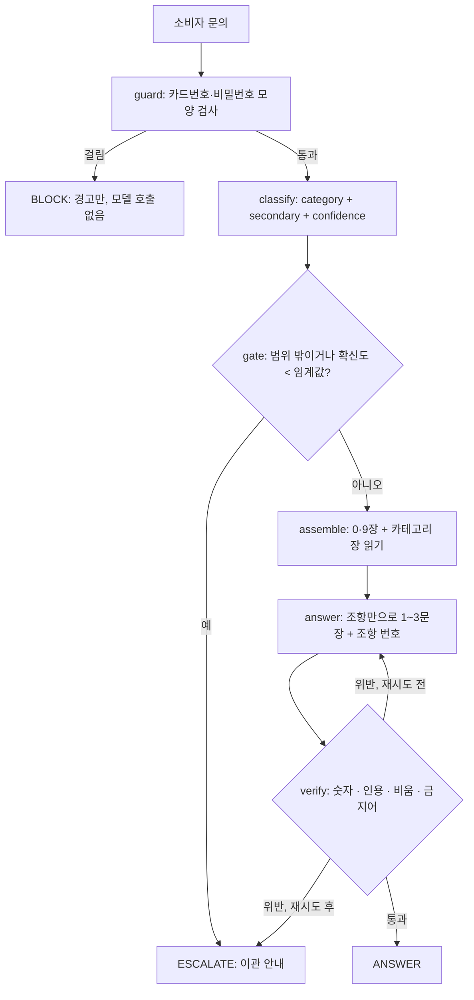

# 기술 명세 · 링커밋 쇼핑몰 소비자 응대 에이전트

작성 2026-11-02 · 짝 문서 [`PRD.md`](PRD.md) · 상태 **구현 시작 전**
PRD 는 **무엇을·왜**(기능·규칙·통과 기준), 이 문서는 **어떻게**(그래프·파일 책임·검사 방법·만드는 순서)를 적는다. 둘이 어긋나면 PRD 를 고치고 이력을 남긴다(PRD 「변경 규칙」).

> 노드의 「필수 구현 내용」은 파일 이름이 아니라 **다섯 가지 일**이다(카테고리·문서 연결 / 평가셋 / 파이프라인 / 측정 / 데모). 제출물로 요구된 문서는 `REPORT.md` 하나이고 `tech_spec.md` 는 노드에 없다. 이 문서는 **내 구현 계획용**이라 제출 구조(`REPORT.md` 7항목)에는 영향이 없다.

## 1. 필수 구현 5가지 ↔ 파일 ↔ 통과 기준

| 노드의 필수 구현 | 만드는 것 | 파일 | PRD 통과 기준 |
|---|---|---|---|
| 1. 카테고리를 정하고 문서와 연결 | 근거 문서 6장, 카테고리↔장 매핑 | `docs/policy/*.md` · `data/mapping.json` | P1 · P2 |
| 2. 평가셋 만들기 | 평가용 20건, 예시용 6건 이상, 중복 검사 | `data/goldenset.json` · `data/fewshot.json` | P4 |
| 3. 파이프라인 구현 | 판정 → 근거 조립 → 답변 → 검증 + 넘기기 | `prompts.py` · `context.py` · `agent.py` | P3 · P9 |
| 4. 측정 | 두 지표 + 분류 지표, 채점기 자기검증, 개선 기록 | `evaluate.py` · `results/` | P5 · P6 · P7 · P8 |
| 5. 데모 만들기 | 답변 + 도구 + 근거 + 검증 + 넘김을 한 화면에 | `app.py` | P10 |
| (제출물) | REPORT 7항목, 키 제외, 새 폴더 실행 | `REPORT.md` · `requirements.txt` · `.gitignore` · `.env.example` | P11 ~ P14 |

## 2. 그래프 (LangGraph)

**State** (`TypedDict`)

| 필드 | 뜻 |
|---|---|
| `question` | 소비자 문의 원문 |
| `category` · `secondary` · `confidence` · `reason` | `classify` 결과. `secondary` 는 없으면 `None` |
| `action` | `ANSWER` · `ESCALATE` · `BLOCK` |
| `called_tools` | `assemble` 이 실제로 부른 읽기 도구 이름 목록 (**기대 도구와 비교하는 값**) |
| `context` · `clause_ids` | 프롬프트에 넣은 조항 본문 · 그 안의 조항 번호 집합 |
| `answer` · `citations` | 답변 문장 · 답변에서 뽑은 `[CS-…]` 번호 |
| `violations` · `retries` | `verify` 가 찾은 위반 목록 · 재생성 횟수(최대 1) |
| `trace` | 노드별 기록(데모와 채점이 읽는다) |

**노드 규칙**

- `guard` — 정규식으로 카드번호(13~19자리 숫자열)·"비밀번호" 모양을 찾는다. 걸리면 모델을 부르지 않고 `BLOCK`.
- `classify` — `pydantic` 스키마: `category`(`Literal` 5개) · `secondary`(`Literal` 4개 또는 `None`) · `confidence`(0~1) · `reason`. 프롬프트의 예시는 `fewshot.json` 에서만 쓴다(**평가셋 누수 방지**).
- `gate` — **모델을 부르지 않는다.** `category == OUT_OF_SCOPE` 이거나 `confidence < 임계값`(초기 0.5)이면 `ESCALATE`. 판정과 넘기기 판단을 나눈다(PRD 규칙 4).
- `assemble` — 읽기 도구를 **코드가 부른다**(모델이 고르지 않는다). 항상 0·9장 + `category` 장 + `secondary` 가 있으면 그 장. 부른 도구 이름을 `called_tools` 에 쌓는다.
- `answer` — 입력은 문의 · 조회한 조항 본문 · 규칙. 존댓말 1~3문장, 문장 끝에 `[CS-…]`. 환불·취소 규칙은 조항 문장을 그대로 인용하게 지시한다. 조회한 조항에 답이 없거나 질문이 `[비움]` 칸에 걸리면 답을 지어내지 않고 `ESCALATE` 로 응답할 수 있어야 한다(평가셋 `[비움]` 4건의 정답 경로 — 순서 3 에서 추가). 재시도 땐 `violations` 를 프롬프트에 붙인다.
- `verify` — **모델을 부르지 않는다**(3절).
- 조건 간선 — `verify` 위반 & `retries == 0` → `answer` 로 되돌림, 위반 & `retries == 1` → `ESCALATE`.

## 3. `verify` 구현 — 기계로 검사하는 네 가지

| 검사 | 방법 | 한계 |
|---|---|---|
| ① 문서에 없는 숫자·기한·금액 | 답변에서 `숫자+단위`(`원` · `일` · `영업일` · `시간` · `개` · `%` · `월`)를 정규식으로 뽑는다. 허용 = **조회한 조항 안의 수 ∪ 문의 속 수 ∪ 그 수들의 한 단계 산술**(곱·합·차). 콤마는 정규화 | 숫자가 없는 오류는 못 잡는다 |
| ② 인용 번호 | `\[CS-[a-z]+-\d+\]` 를 뽑아 **`clause_ids` 안에 있는지** 본다. `ANSWER` 인데 인용이 0개면 위반 | 인용만 맞고 내용이 틀린 것은 못 잡는다 |
| ③ `[비움]` 단정 | 장마다 `[비움]` 항목의 **단서어 목록**(예: 환불 입금 기간 → `입금` · `영업일`, 결제수단 → `카드` · `페이`)을 두고, 답변에 단서어가 **사실처럼** 들어가면 위반 | 단서어 밖의 표현은 놓친다 |
| ④ 금지 표현 | `공구가` · `공구기간` · 내부 영문 상태명(`paid` `confirmed` `refunded` `preparing` `shipped` `delivered`) | 목록에 있는 말만 |

10/30 교훈 — **1,000 미만 숫자를 건너뛰면** "재입고 예정일은 9월 15일"이 통과했다. 그래서 ①은 **기한 단위(`일` · `영업일` · `시간` · `월`)는 크기와 상관없이** 검사한다. 위 한계는 `forbid` 채점이 받친다(숫자 없는 오류는 채점에서 잡는다).

## 4. 파일 책임과 함수

| 파일 | 책임 | 주요 함수 |
|---|---|---|
| `prompts.py` | 분류 지침(카테고리 정의 · 경계 기준 · 확신도 지침) · 답변 규칙 · 채점 지침 | `ROUTE_GUIDE` · `ANSWER_RULES` · `JUDGE_RULES` |
| `context.py` | 장 파일 읽기 · 조항 파싱 · 읽기 도구 · 컨텍스트 조립 · 중복·누수 검사 | `load_chapters()` · `get_order_policy()` 외 3개 · `assemble_context(category, secondary)` · `check_split()` |
| `agent.py` | 모델 어댑터 · State · 노드 · 그래프 · `verify` | `make_model(role)` · `build()` · `run(question)` |
| `evaluate.py` | 골든셋 실행 · 두 지표 · 분류 지표 · 채점기 자기검증 · 결과 저장 | `run_eval(tag)` · `grade(item, out)` · `check_grader()` |
| `app.py` | `streamlit` 데모 | 사이드바 예시 문의(**예시용에서만**) · 결과 패널 |

**조항 형식** — 장 파일은 PRD 의 front-matter 를 쓰고, 조항은 한 줄씩 `**[CS-cancel-2]** 문장 [확정: 출처 파일]` 또는 `**[CS-cancel-7]** … [비움]`. 장 이름표(`slug`)는 `common` · `order` · `product` · `shipping` · `cancel` · `scope` (PRD 예시 `[CS-cancel-2]` 와 같다). 읽기 도구 네 개는 각각 `order` · `product` · `shipping` · `cancel` 장 파일의 **조항 본문만** 돌려준다(front-matter 제외).

**모델 어댑터** — 10/30 실습과 같은 방식이다. `.env` 에서 `GEMINI_API_KEY` 를 읽어 `OPENAI_API_KEY` 로, `OPENAI_BASE_URL` 은 `https://generativelanguage.googleapis.com/v1beta/openai/` 로 설정하고 `init_chat_model("openai:…")` 을 부른다. 역할별 환경변수는 이식을 생각해 처음부터 아래 이름으로 둔다.

| 환경변수 | 역할 | 값(10/30 설정 그대로, PRD 「모델」) |
|---|---|---|
| `CS_ROUTER_MODEL` | `classify` | `openai:gemini-flash-latest` |
| `CS_ANSWER_MODEL` | `answer` | `openai:gemini-2.5-flash` |
| `CS_JUDGE_MODEL` | 답변 적절성 채점 | `openai:gemini-flash-latest` |

`.env.example` 에는 이름만 쓴다(값 없음). 호출은 `temperature=0`, `timeout=60`, `max_retries=2`(10/30과 같다). **키가 없으면** `make_model` 이 예외를 던지는 대신 `agent.run` 과 `app.py` 가 **안내 문구만** 보여 준다(P11).

## 5. 평가 구현 (`evaluate.py`)

- **입력** — `goldenset.json` 20건: `{id, category, question, action, tools[], must[], forbid[], boundary?, reference}`.
- **도구 호출 적절성** — `set(called_tools) == set(tools)` 이면 1점. 범위 밖 문항은 `tools` 가 빈 집합이라 **읽기를 한 번이라도 하면 0점**. `[비움]` 때문에 넘기는 문항은 **먼저 읽고 넘긴다**(읽기 먼저, 게이트 B-2)라서 그 카테고리 도구가 기대 도구다 — 읽지 않고 넘기면 0점(2026-11-02 순서 3 에서 고침, 이전 문구는 둘을 한데 묶어 서로 어긋났다).
- **답변 적절성** — `must` 를 전부 담고 `forbid` 를 하나도 어기지 않으면 1점. 판정은 `CS_JUDGE_MODEL` 이 하고, 지침에 **표현이 아니라 사실을 보라**고 적는다. `ESCALATE` 가 정답인 문항은 `action == ESCALATE` 이면서 `forbid` 가 없을 때 1점.
- **분류 지표(계산만 해 둔다)** — 정답 카테고리와 `category` 를 비교해 정확도 · macro F1 · 혼동 행렬(`scikit-learn`). 제출에 넣을지는 수업에서 확인(PRD 「수업에서 강사에게 확인할 것」 2).
- **채점기 자기검증** — `check_grader()` 가 ① `reference` 20건을 채점해 **전부 통과**하는지, ② `reference` 뒤에 그 문항의 `forbid[0]` 을 이어 붙인 **오답 3건**이 전부 **불통과**하는지 본다(P5). 이게 통과한 뒤에만 측정 결과를 믿는다.
- **누수 검사** — `check_split()` 이 `goldenset` 과 `fewshot` 의 `id` · 질문 문장 중복이 0 인지 센다(P4).
- **동시 호출** — `ThreadPoolExecutor` 로 최대 6 (10/30 은 12에서 `429` 없음, 막히면 4로).
- **결과 저장** — `results/run_<YYYYMMDD-HHMM>_<tag>.json` 한 개에 **모델 이름 3개 · 측정일 · 임계값 · 문항별 기록 · 요약**을 담는다. `-latest` 별칭이 움직이므로 REPORT 4번 표에는 이 값을 그대로 옮긴다(P13).
- **개선 기록** — 한 번에 하나만 바꾸고 `--tag` 를 달리해 다시 재서, 전·후를 REPORT 4번 개선 표에 옮긴다(P8, 최소 2회).

## 6. 만드는 순서 — 단계마다 눈으로 확인한다

| 순서 | 할 일 | 확인 | PRD |
|---|---|---|---|
| 0 | 새 폴더 준비: `.venv`(파이썬 3.12) · `requirements.txt`(10/30 `.venv` 의 `pip freeze` 에서 쓰는 패키지 버전 확인 후 고정) · `.gitignore`(`.env` `.venv` `results/` 제외 여부 결정) · `.env`(10/30 값 복사, 저장소 금지). **호출 한 번**으로 두 모델 이름이 아직 열려 있는지 확인 | 두 모델이 각각 응답한다. 안 열리면 PRD 를 고친다 | — |
| 1 | 근거 문서 6장 작성(`[확정]`+출처 파일 / `[비움]`, `[가정]` 없음). **가장 오래 걸리는 단계라 먼저** | 태그 개수 세기, 5,000자 이상, `[비움]` 4개 이상 | P1 |
| 2 | `data/mapping.json` + `context.py`(조항 파싱 · 읽기 도구 · 조립) | 카테고리 5개 모두 연결, 0·9장에 카테고리 전용 숫자 없음 | P2 · P3 |
| 3 | `fewshot.json` · `goldenset.json`(문장은 소비자 말투) + `check_split()` | 20건 분포 · 넘기기 8건 · 중복 0 | P4 |
| 4 | `classify` + `gate` 만 먼저 그래프로 만들어 평가셋 20건에 돌린다 | 분류 정확도 · 혼동 행렬 · 넘긴 건수 | P6 일부 |
| 5 | `assemble` · `answer` · `verify` 를 이어 전체 그래프 완성, 질문 몇 개로 손으로 시험 | 인용 번호 · 읽은 장 · 위반 로그 | P9 |
| 6 | `evaluate.py` + `check_grader()` | **모범 답안 20건 전부 통과, 오답 3건 전부 불통과** | P5 · P6 |
| 7 | 첫 측정 → 틀린 건 직접 읽고 원인(분류·조회·생성·검증) 표 → 한 번에 하나 고쳐 재측정 ×2 이상 | 전·후 표 | P7 · P8 |
| 8 | `app.py` — 정상 3 · 넘기기 2 · 카드번호 모양 1 직접 시연, 화면 캡처 | 한 화면에 다 보인다 | P10 |
| 9 | `REPORT.md` 7항목을 사실로 채움(`results/` 값 그대로) | 1번에 근거 문서 출처, 4번에 모델·측정일 | P13 |
| 10 | 제출 전 — 새 폴더에 내려받아 설치 → 키 없이 안내 → 키 넣고 끝까지 · `git ls-files` 에 키 없음 · 마지막 커밋 해시와 실행 화면을 `작업기록.md` 에 | 명령 출력 | P11 · P12 · P14 |

순서 1 이 느려질 수 있으니 **막히면 장 하나를 끝낸 단계까지만 쓰고** 평가셋 문항은 그 장 기준으로 줄이지 않는다(문항 분포가 흐트러진다). 시간이 모자라면 PRD 를 고쳐 범위를 줄이고 이력에 적는다.

## 7. 알려진 함정 (10/30 실측)

| 증상 | 원인 → 대응 |
|---|---|
| `400 … missing a thought_signature` | 답변 모델이 3.x 계열 → `CS_ANSWER_MODEL` 은 `gemini-2.5-flash` |
| `429` / `RESOURCE_EXHAUSTED` | 동시 호출 과다 → 동시 6 → 4 로 낮추고 1분 뒤 그 문항만 다시 |
| 첫 실행이 몇 분째 돈다 | 패키지 첫 로딩 → 기다린다 |
| 모델 이름이 같은데 점수가 달라짐 | `-latest` 별칭이 움직임 → 측정일과 모델 이름을 결과 파일에 남긴다 |
| `NameError` 같은 앞 단계 누락 | 순서를 건너뜀 → 6절 순서대로 |

## 8. 이 명세가 PRD 에 더한 것 (PRD 에도 반영함)

1. `classify` 출력에 **`secondary`** 를 더했다 — PRD 평가셋이 "한 문장에 두 카테고리가 섞인 문항은 `tools` 가 두 개"라고 하는데(예: S3 `배송중`+`취소됨`), 카테고리를 하나만 내면 두 번째 장을 읽을 길이 없다.
2. `verify` 에 **④ 금지 표현** 검사를 더했다 — PRD P9(영문 상태명·`공구가` 0건)를 문서 규칙이 아니라 **기계 검사**로 받친다.
3. 조치 `action` 에 **`BLOCK`**(카드번호 모양 입력) 값을 더했다. 평가셋 `action` 은 `ANSWER` · `ESCALATE` 만 쓴다.
4. 폴더에 **`results/`**(측정 결과 JSON) · **`report-img/`**(REPORT 의 화면 캡처)를 더했다.
5. 조항 이름표 `slug` 를 `common` `order` `product` `shipping` `cancel` `scope` 로 정했다.
